# Imagination-Head Project: Architecture and Pipeline Diagrams

All diagrams are Mermaid flowcharts. To render them: open this file in VS Code with a Markdown preview that supports Mermaid, or paste any code block into https://mermaid.live , or view it on GitHub.

Colour legend used in every diagram: **green** = done and run, **blue** = idea or design, **orange** = key finding, **grey dashed** = planned or never run, **red** = failure or flawed result.

| # | Diagram | What it shows |
|---|---------|---------------|
| 1 | Project journey | Every phase in order, with the decision each result caused |
| 2 | Original PDF architecture | The design in `research_plan_new.pdf` |
| 3 | Steps 1 to 7 | The basic modules (SmolLM2-135M) |
| 4 | Steps 8 to 8d | Joint training and the control experiments |
| 5 | Advanced track pipeline | A0, A, B, C with the data and checkpoints |
| 6 | Core architecture (answer-first) | What actually runs at test time and in training |
| 7 | Phase B losses | How the Imagination Head is trained |
| 8 | Evaluation conditions | What oracle / wrong / const / own / own_shuffled feed in |
| 9 | Datasets and leak audit | ScienceQA, spatial v1 (leaky), spatial v2 (clean) |
| 10 | Planned: multi-step grid_walk | The next experiment (per-step imagination) |
| 11 | Future idea: dual-stack | The two-stack cross-attention idea |
| 12 | Programs and checkpoints map | Which script produces and consumes what |

---

## 1. Project journey (all phases and decisions)

```mermaid
flowchart TD
    classDef done fill:#d4f4dd,stroke:#2e7d32,color:#000
    classDef idea fill:#dbe9ff,stroke:#1565c0,color:#000
    classDef finding fill:#ffe0b2,stroke:#e65100,color:#000
    classDef bad fill:#ffcdd2,stroke:#c62828,color:#000
    classDef planned fill:#eeeeee,stroke:#757575,stroke-dasharray: 5 5,color:#000

    PDF["research_plan_new.pdf<br/>Imagination Head + Gate + feedback loop + anti-collapse<br/>4 training stages, LoRA bf16"]:::idea

    subgraph T1["Track 1 - SmolLM2-135M, ScienceQA chain-of-thought (steps 1 to 8d)"]
        direction TB
        S17["Steps 1-7: modules built and sanity-checked<br/>backbone, head, gate, feedback chain,<br/>COCO alignment, gate, retrieval"]:::done
        S8["Step 8: joint training, LLM frozen<br/>LM loss 1.65 to 1.33, benefit 0.34 to 0.70"]:::done
        S8b["Step 8b: controls<br/>feedback 1.3324, shuffled 1.3451,<br/>random 1.5630, constant 2.0355"]:::done
        S8c["Step 8c: teacher forcing + LoRA, k=4 tokens<br/>own_info_gain +0.0126, unstable across epochs"]:::done
        S8d["Step 8d: 150 fresh questions + bootstrap CI<br/>image content usable +0.0010, not distinguishable"]:::done
        F1{{"Finding 1: the gain was a soft-prompt effect<br/>the text-only LLM never read image content"}}:::finding
        S17 --> S8 --> S8b --> S8c --> S8d --> F1
    end

    subgraph T2["Track 2 - Qwen2.5-0.5B, answer-first, reader (CLIP to LLM tokens)"]
        direction TB
        A0["A0: caption alignment of the reader on 20,000 COCO images<br/>true 2.447 vs wrong 3.476 vs blank 2.939 - PASSED"]:::done
        ASQ["Phase A on ScienceQA (4 runs)<br/>global, grid3, grid3+contrast, grid3 after A0<br/>oracle = wrong = blank, about 70% - NOT PASSED"]:::bad
        DIAG["imagine_diagnose_data.py<br/>65% have hints, 14% contain the gold string,<br/>26% knowledge questions"]:::done
        F2{{"Finding 2: ScienceQA is text-solvable<br/>swapping the image changes nothing"}}:::finding
        V1["Spatial v1 built by Cursor agent<br/>80,000 items, 8 families"]:::done
        AV1["Phase A on v1: oracle 100.0, wrong 58.3, blank 99.2<br/>looks like a pass"]:::bad
        AUD1["imagine_audit_data.py on v1<br/>8 of 8 families flagged"]:::done
        F3{{"Finding 3: v1 leaks the answer<br/>verdict text and green/red colour in images,<br/>answer index 0, choice sets encode the answer"}}:::finding
        V2["Spatial v2 built, leak-free<br/>imagine track + see track + test_ood"]:::done
        AUD2["Audit on v2: 0 of 8 flagged"]:::done
        AV2["Phase A on v2: oracle 81.8, wrong 73.8, blank 76.9<br/>oracle vs wrong +8.10 pts, SUPPORTED"]:::done
        EV["Eval on test_ood<br/>triangle: oracle 98.2, blank 52.0 (chance)"]:::done
        G7["Grid 7 run without A0 alignment<br/>inconclusive, confounded"]:::bad
        PB["Phase B: train only the Imagination Head<br/>20.2 M params, 3 epochs, about 17 min each"]:::done
        PC["Phase C: held-out test and test_ood"]:::done
        F4{{"Finding 4: own imagination is example-specific<br/>+2.45 pts val, +1.99 pts test over own_shuffled<br/>but own ties blank, and fails on OOD triangle (51.7 vs 52.0)"}}:::finding
        A0 --> ASQ --> DIAG --> F2 --> V1 --> AV1 --> AUD1 --> F3 --> V2 --> AUD2 --> AV2 --> EV --> G7 --> PB --> PC --> F4
    end

    NEXT["Planned next experiments"]:::planned
    N1["Multi-step grid_walk chain<br/>per-step imagined board state (the PDF loop)"]:::planned
    N2["Grid 7: run A0 for grid 7, then Phase A"]:::planned
    N3["Gate with empirical target<br/>CE(const) minus CE(own), blend tokens"]:::planned
    N4["Co-adapt the reader, photo VQA (A-OKVQA),<br/>GRPO steps 9-10, dual-stack ablation"]:::planned

    PDF --> T1
    F1 -->|"decision: bigger model, answer-first,<br/>aligned reader, controls with CIs"| T2
    F4 --> NEXT
    NEXT -.-> N1
    NEXT -.-> N2
    NEXT -.-> N3
    NEXT -.-> N4
```

---

## 2. Original architecture from `research_plan_new.pdf`

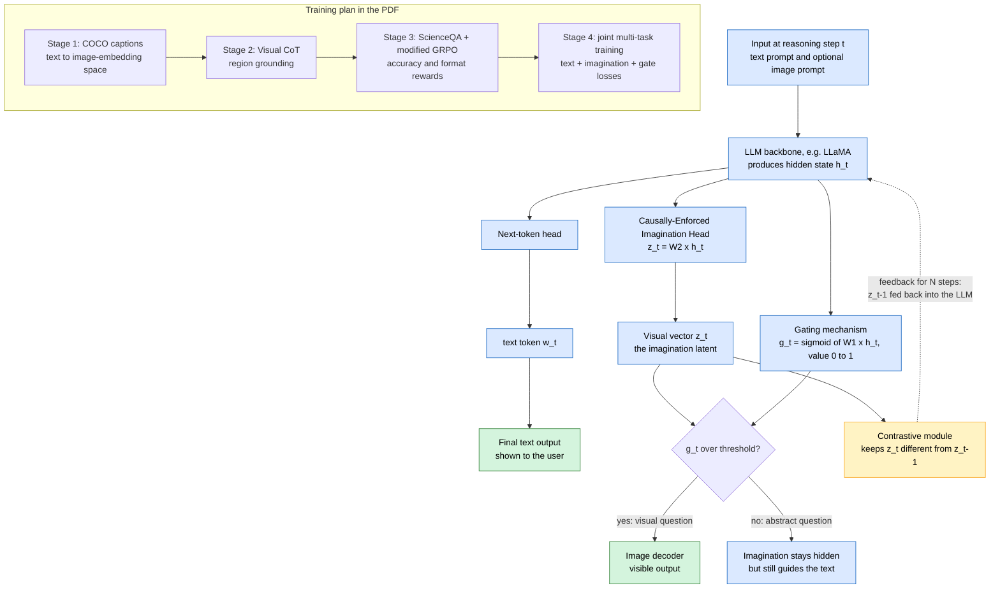

---

## 3. Steps 1 to 7: building the basic modules (SmolLM2-135M)

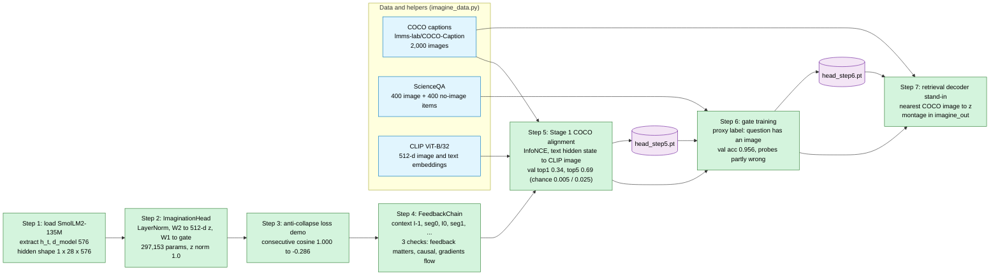

---

## 4. Steps 8 to 8d: joint training and the control experiments

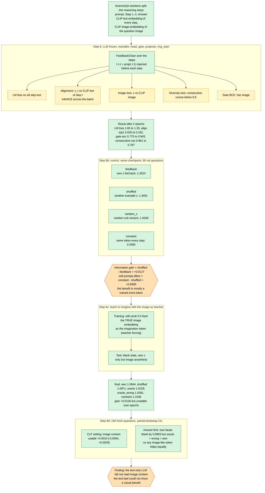

---

## 5. Advanced track pipeline (A0, A, B, C)

```mermaid
flowchart LR
    classDef done fill:#d4f4dd,stroke:#2e7d32,color:#000
    classDef data fill:#e1f5fe,stroke:#0277bd,color:#000
    classDef ckpt fill:#f3e5f5,stroke:#6a1b9a,color:#000
    classDef planned fill:#eeeeee,stroke:#757575,stroke-dasharray: 5 5,color:#000

    subgraph DATA["Data"]
        direction TB
        COCO20["COCO 20,000 images + captions"]:::data
        V2["Spatial v2 JSON + images<br/>train 40,000 / val 3,000 / test 3,000 / test_ood 2,000<br/>(Phase A and B use 20,000 / 2,000 / 2,000)"]:::data
        FEAT["CLIP features, cached<br/>penultimate patch tokens pooled to 3x3<br/>9 tokens x 768-d per image"]:::data
    end

    A0["A0 alignment<br/>imagine_step8_advanced_a0.py<br/>LLM frozen, train Reader on captions<br/>2 epochs"]:::done
    RA0[("adv_a0_*/reader.pt<br/>one per grid size")]:::ckpt

    PA["Phase A<br/>imagine_step8_advanced_a.py<br/>train Reader + LoRA (r=16) on the answer letter<br/>blank tokens used 15% of the time"]:::done
    CA[("adv_a_*_spatial2/<br/>reader.pt + lora/")]:::ckpt
    EVA["a_eval<br/>imagine_step8_advanced_a_eval.py<br/>no training, per-family accuracy on any split"]:::done

    PB["Phase B<br/>imagine_step8_advanced_b.py --track imagine<br/>train only the Imagination Head<br/>Reader, LoRA, LLM frozen"]:::done
    CB[("adv_b_*_spatial2_imagine/head.pt")]:::ckpt

    PC["Phase C<br/>imagine_step8_advanced_c.py<br/>held-out test and test_ood,<br/>per-group tables, retrieval gallery PNG"]:::done
    OUT["imagine_out/*.png<br/>+ tables with bootstrap CIs"]:::done

    G7["A0 and Phase A for grid 7<br/>(49 tokens x 768-d)"]:::planned

    COCO20 --> A0
    FEAT --> A0
    A0 --> RA0 --> PA
    V2 --> FEAT
    FEAT --> PA
    PA --> CA
    CA --> EVA
    CA --> PB
    FEAT --> PB
    PB --> CB
    CA --> PC
    CB --> PC
    FEAT --> PC
    PC --> OUT
    G7 -.-> PA
```

---

## 6. Core architecture (answer-first, what runs at test time and in training)

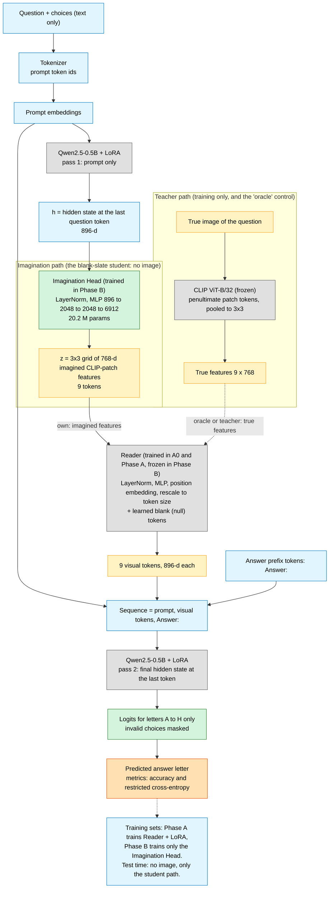

---

## 7. Phase B: how the Imagination Head is trained

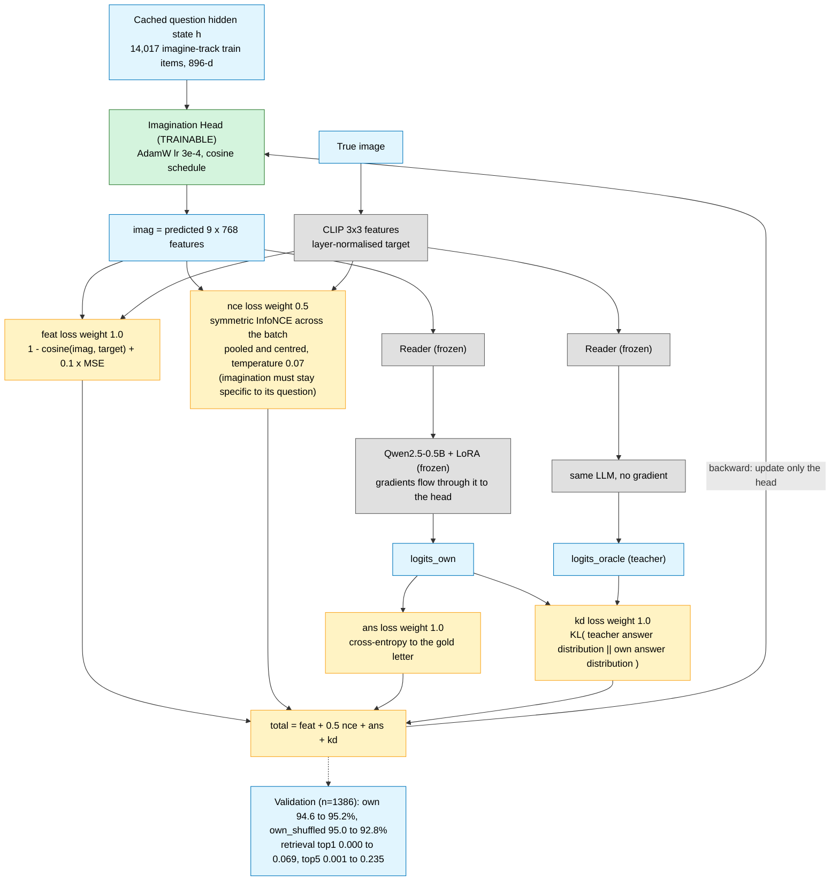

---

## 8. Evaluation conditions: what each condition feeds into the LLM

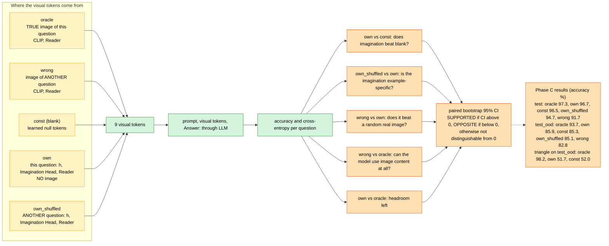

---

## 9. Datasets and the leak audit

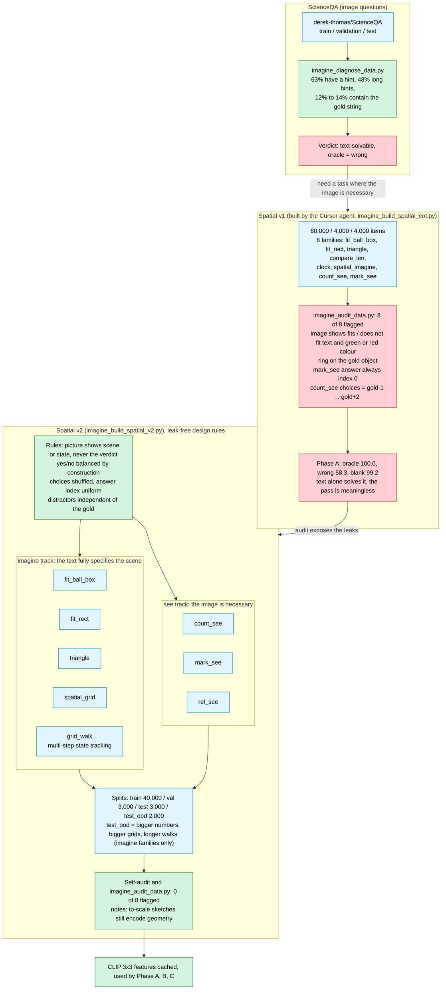

---

## 10. Planned: multi-step `grid_walk` chain (not yet implemented)

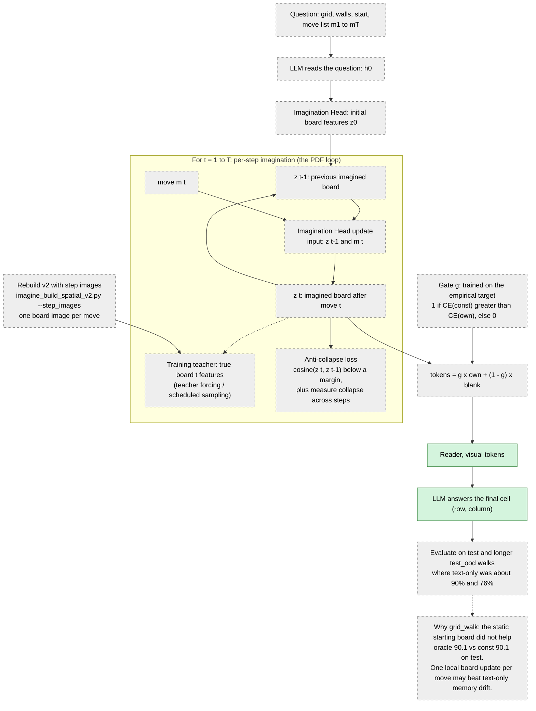

---

## 11. Future idea: dual-stack with bidirectional cross-attention (not started)

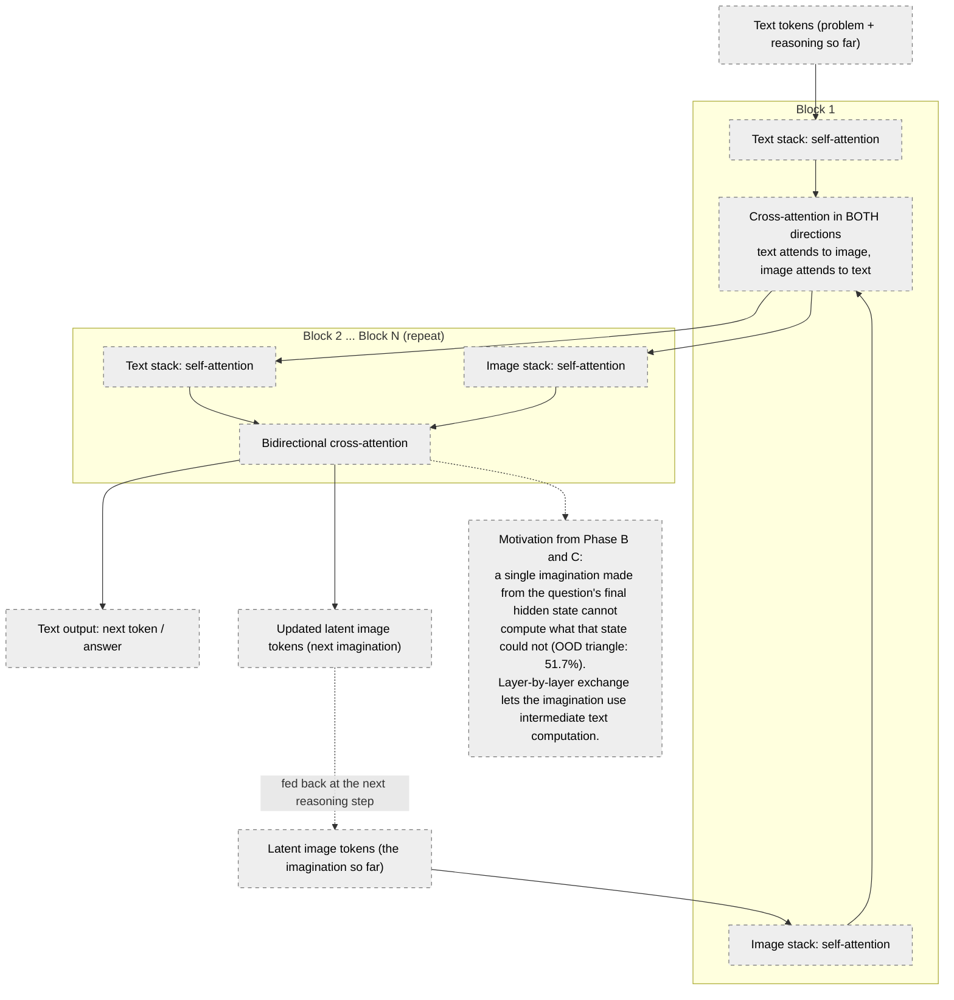

---

## 12. Programs and checkpoints map

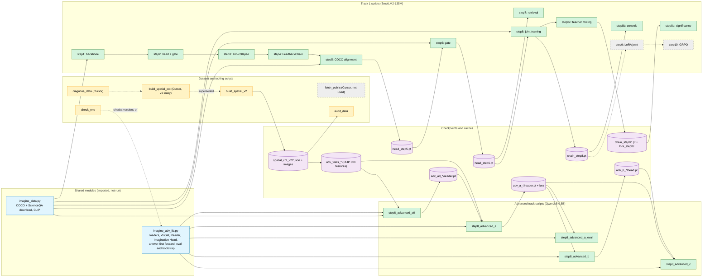
